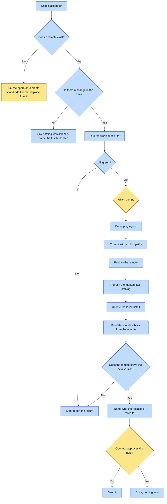

# Purpose
A change to this plugin reaches every machine that runs it, and the release proves delivery
against the remote rather than assuming it. The outcome is a verified installed version,
not a green local run.

# When to use (Trigger)
Anything in this plugin changed and should reach other people, or somebody says "ship it",
"cut a version", "release the plugin". Also the front door when the change does not exist
yet: a clean tree is a state, not an error.

# Inputs / Prerequisites
- A git remote, created BY THE OPERATOR on their own account, with the marketplace added
  from that remote rather than from the local clone. The stamp leaves a repository with no
  remote on purpose: which account and which visibility are not a machine's to guess.
- Push access to it.
- A working tree that holds only the change being shipped. Read it first; this ships
  whatever is there.
- The whole test suite runnable locally with `./run-tests.sh`.

# Roles
| Role | Responsibility |
|---|---|
| **Human operator** | Creates the remote and adds the marketplace from it, once per plugin. Decides the bump when it is not obvious, approves anything that reaches a person, owns the call to ship at all. |
| **Agent executor** | Runs the suite, bumps, commits with explicit paths, pushes, refreshes the catalog, updates, verifies against the remote. |

# Procedure
0. Check for a remote. If there is none, stop and ask the operator to create one on their own
   account, add it as `origin`, add the marketplace from that remote, and set `owner.name` in
   `.claude-plugin/marketplace.json`. Nothing below works without it, and none of it is yours
   to decide. Effort: unknown.
1. Read the working tree. If it is clean, say nothing was shipped and name the first step of
   building the change, rather than refusing. Effort: unknown.
2. Run the whole suite. Red stops everything. Effort: unknown.
3. Bump the version in `.claude-plugin/plugin.json`: patch, minor, or major by what moved. Effort: unknown.
4. Commit, naming every path explicitly. Effort: unknown.
5. Push. Effort: unknown.
6. Refresh the marketplace catalog. Effort: unknown.
7. Update the local install. Effort: unknown.
8. Read the published manifest back from the remote and compare it to the version just cut. Effort: unknown.
9. Check the version actually installed. Effort: unknown.
10. Read the release's commits for attribution trailers and draft a note to each person named;
    send only on the operator's approval. Effort: unknown.

# Process Timeline
Who does what, and how long. No length here is measured or estimated yet: this map is
stamped with the plugin, before anyone has run it, so every step is drawn as a dashed
placeholder rather than at a length nobody gave. The first real run fills each one in with
the effort the operator gives, or the one that run measured.

```mermaid
%%{init: {"themeCSS": ".task0 { fill: #fde68a; stroke: #b45309; } .task1 { fill: #bfdbfe; stroke: #1e40af; } .task2, .task3 { fill: #e5e7eb; stroke: #4b5563; } .active0 { fill: #ffffff; stroke: #b45309; stroke-dasharray: 4 3; } .active1 { fill: #ffffff; stroke: #1e40af; stroke-dasharray: 4 3; } .active2, .active3 { fill: #ffffff; stroke: #4b5563; stroke-dasharray: 4 3; } .taskText0, .taskText1, .taskText2, .taskText3 { fill: #111827; }"}}%%
gantt
    dateFormat X
    axisFormat %s
    todayMarker off
    section Operator
    Create the remote (unknown) :active, s0b, after s0, 5s
    Decide the bump (unknown) :active, s3b, after s2, 5s
    Approve the note (unknown) :active, s10b, after s10, 5s
    section Agent
    Check for a remote (unknown) :active, s0, 0, 5s
    Read the working tree (unknown) :active, s1, after s0b, 5s
    Run the whole suite (unknown) :active, s2, after s1, 5s
    Bump the version (unknown) :active, s3, after s2, 5s
    Commit by explicit paths (unknown) :active, s4, after s3 s3b, 5s
    Push (unknown) :active, s5, after s4, 5s
    Refresh the catalog (unknown) :active, s6, after s5, 5s
    Update the local install (unknown) :active, s7, after s6, 5s
    Read the manifest back (unknown) :active, s8, after s7, 5s
    Check the installed version (unknown) :active, s9, after s8, 5s
    Draft a note to whoever is owed (unknown) :active, s10, after s9, 5s
```

# Process Flowchart
Optional, and kept because every gate in a release is a branch that refuses, and they are the point of this verb.
Amber = irreducibly human. Blue = agent-executed or agent-proposed.

# Done / Verification
The remote serves the new version, and the installed version matches it. Both are read back
rather than assumed. A local file showing the right number proves the one thing nobody
doubted.

# Exceptions & Troubleshooting
- **There is no remote.** The first release of a freshly stamped plugin always meets this.
  Stop and hand it to the operator; never create a repository under whatever account happens
  to be authenticated on this machine, because publishing somebody's plugin to the wrong
  account is not something anybody can quietly undo.
- **The marketplace was added from the local clone.** Every update then reports "already at
  the latest version", correctly, forever. Re-add it from the remote.
- **The push is rejected.** Fetch, rebase, re-run the suite, push again. Never force-push
  over history somebody else may hold.
- **The update reports "already at the latest version".** Either the version was not bumped,
  or the push did not land, or the catalog clone was not refreshed. All three look the same
  from here; check them in that order.
- **The remote still serves the old version.** Stop. Do not report a release. A remote that
  has not caught up is a release that has not happened.
- **The tree holds unrelated work.** Stop and say which files. This ships whatever is there.

# Automation Opportunities
Already automatic: the ordering, which is where hand-run releases fail. Strongest next
candidate: a release script that performs steps 2 through 9 and refuses at each, so the order
stops depending on the reader. Irreducibly human: the bump when it is a judgement call, and
every message that reaches a person.

# Related
- `overnight-cos`, the front door that routes here.

# Revision History
| Version | Date | Changes |
|---|---|---|
| 0.1 | 2026-10-17 | Initial draft, from the Freedom plugin skeleton. |
